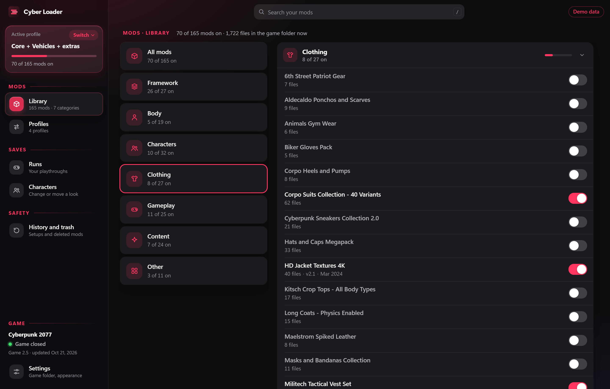
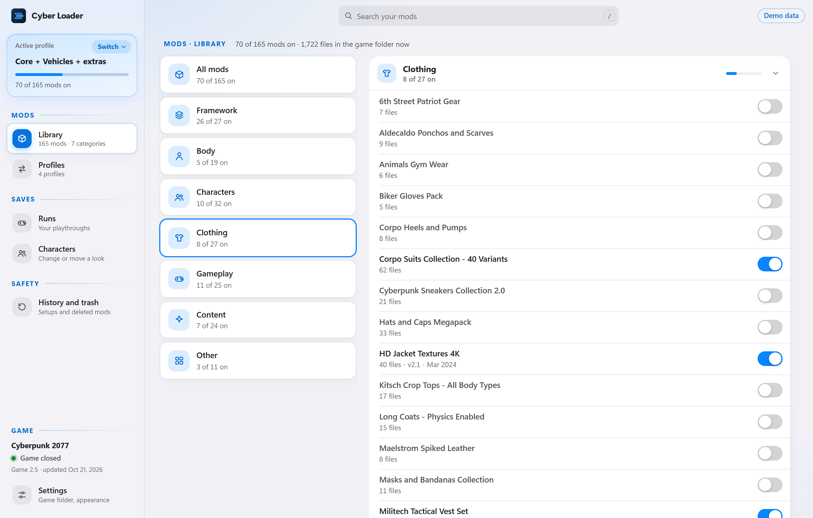
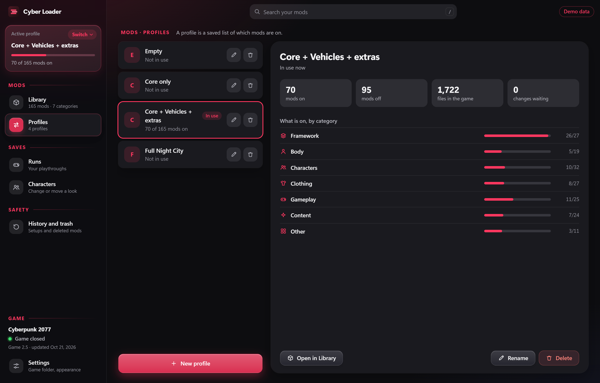
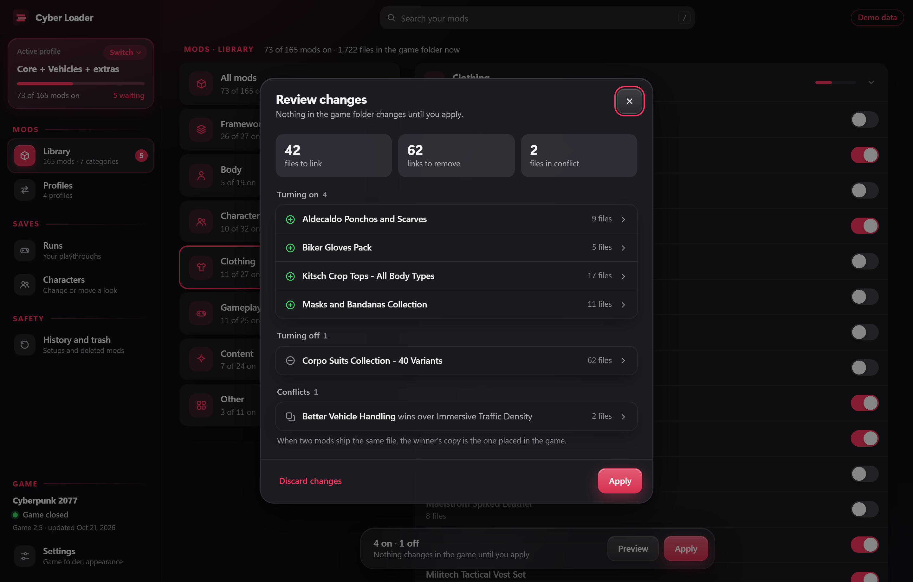
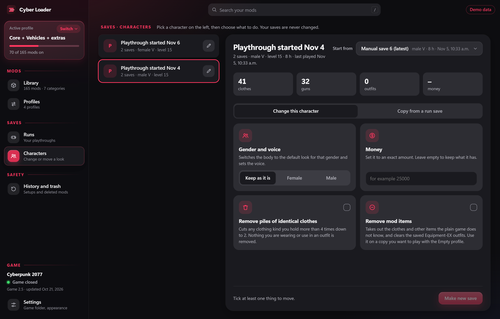

# Cyber Loader

A small, safe mod manager for **Cyberpunk 2077** on Windows. Keep every mod in one library, group them into **profiles**, and switch a whole profile on or off with one **Apply**. Cyber Loader links the files into the game and later removes exactly the files it put there, so nothing is left behind.

> Unofficial fan project. Not affiliated with or endorsed by CD Projekt Red. Cyberpunk 2077 is their trademark.

## Download

Get the latest installer from the **[Releases page](../../releases/latest)**: `CyberLoader-Setup-<version>.exe` (about 14 MB). Windows 10/11, no administrator rights needed.

Windows may show a blue "Windows protected your PC" screen because the installer is not code-signed yet. Choose **More info**, then **Run anyway**. You can check the download against the `.sha256` file on the release page:

```
certutil -hashfile CyberLoader-Setup-<version>.exe SHA256
```

## Screenshots

All screenshots use invented sample mods.



| | |
|---|---|
|  |  |





## What it does

- **A side bar for everything:** Library, Profiles, Runs, Characters, History and trash, and Settings are all pages you switch between from one side bar. Your active profile and the game's state are always visible.
- **Library:** every mod lives in its own folder, laid out like the game folder. Drag a `.zip`, `.7z`, `.rar` or a plain folder onto the window to add it. Nothing from an archive is ever run. Pick a category on the left to jump to it on the right.
- **Profiles:** a profile is a list of which mods are on. "Empty" is the plain game. Make as many as you like.
- **Apply:** shows exactly which files will be added and removed, then does it. Mods are hardlinked into the game (instant, no extra disk space) when the library is on the same drive as the game, and copied otherwise.
- **Safe by design:**
  - Only files Cyber Loader recorded itself are ever removed.
  - A file you changed after it was placed is left alone and reported.
  - A file that already exists and is not Cyber Loader's blocks the apply. Nothing is overwritten.
  - Apply refuses to run while the game is open.
- **Trash:** deleting a mod moves it to the app's own trash, so you can restore it.
- **Characters (optional add-on):** copy the gender, look, clothes, outfits or guns of one Cyberpunk save onto another, or just change a character's gender. It always makes a new save and backs up first. It is built on the MIT-licensed [CP2077SaveEditor](https://github.com/Deweh/CyberCAT-SimpleGUI) and is not part of the installer; see [docs/SAVE-TRANSFER.md](docs/SAVE-TRANSFER.md).
- Light, dark or system theme with an accent colour, including your own colour from a built-in colour picker. The logo in the corner follows the accent. A fresh install starts dark with a pink-red accent; your own choice always wins.

## Install

Run the installer. The wizard asks for:

1. **Install folder** (default: your local app data).
2. **Cyberpunk 2077 folder.** Found automatically on Steam, GOG and Epic, or browse to it.
3. **Where your mod library lives.** Keep it on the same drive as the game so mods are linked instead of copied.
4. **Options:** 7-Zip (recommended, needed for `.7z` and `.rar` mods; plain `.zip` works without it), Start menu shortcut (on by default), Desktop shortcut (off by default).

Updating: run a newer installer over the old one and point it at the same folder. Your library, profiles and trash are kept. Uninstall from Windows Settings, Apps, or with `Uninstall.exe` in the install folder.

Silent install: `Setup.exe /S /D=<install dir> /GAME=<game dir> /DATA=<data dir> [/7ZIP=0] [/DESKTOP] [/NOSTART]`. See [docs/INSTALL.md](docs/INSTALL.md).

## Build it yourself

You need Windows, Python 3.13, 7-Zip, and the C# compiler that ships with Windows.

```
cd engine
python -I -m unittest discover -s tests      # run the tests
cd ..
python tools\package.py --test               # quick build into dist\<version>-test\
```

Layout:

- `engine/` Python engine (standard library only) and its local API. Tests are in `engine/tests`.
- `ui/` the interface (plain HTML, CSS and JavaScript). It also runs on its own against fake data with `?mock=1`.
- `launcher/` the window host (Microsoft WebView2).
- `installer/` the setup wizard.
- `tools/` build and development scripts.
- `docs/` API notes and install details.

## Notes

- Tested on Windows 11 with the Steam version of the game. Other setups should work but have had less testing.
- Cyber Loader only changes the game folder when you press Apply, and keeps a record of everything it placed.
- Bugs and ideas are welcome on the [issue tracker](../../issues).

## License

[MIT](LICENSE). Third-party components (Microsoft WebView2, Python, 7-Zip) keep their own licenses, listed in `installer/THIRD_PARTY.txt` and `launcher/vendor/webview2/LICENSE.txt`.
